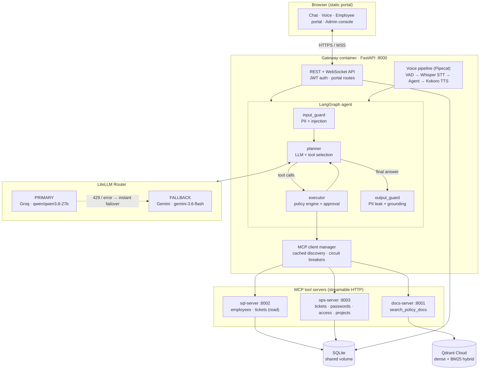
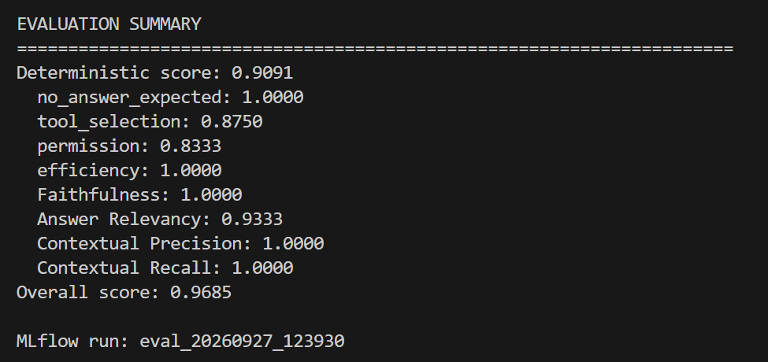
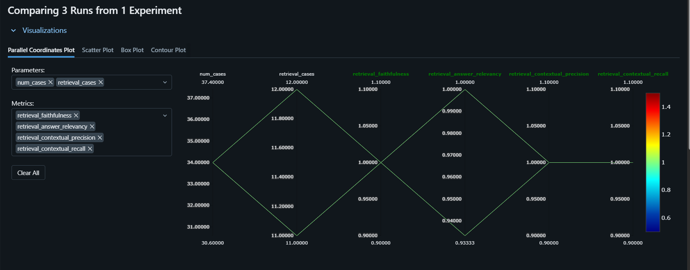
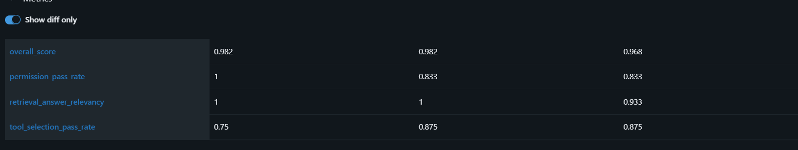
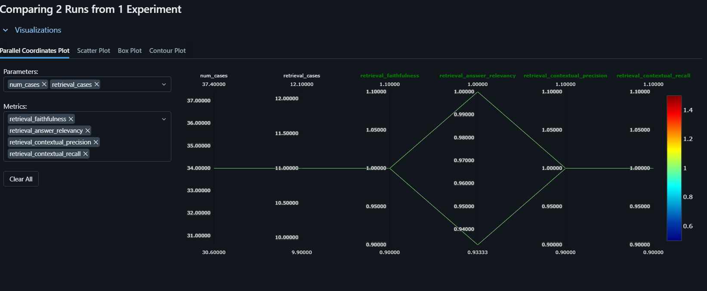
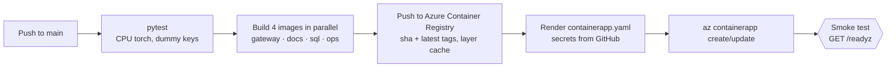

<div align="center">

# 🛰️ OpsPilot

### Voice + MCP-Native AI Operations Agent

**Talk or type to an AI that answers IT policy questions, manages tickets and projects, and performs privileged actions — only after policy checks and human approval.**

[](https://opspilot-app.delightfulwater-bc736702.koreacentral.azurecontainerapps.io)
[](.github/workflows/ci-cd.yml)


**[🚀 Live demo](https://opspilot-app.delightfulwater-bc736702.koreacentral.azurecontainerapps.io)** · **[📊 Evaluation results](#-evaluation)** · **[🏗️ Architecture](#-architecture)** · **[⚡ Quick start](#-quick-start-docker-compose)**

</div>

---

## 📌 TL;DR (for recruiters and hiring managers)

OpsPilot is a **production-style, deployed AI agent** — not a notebook demo. It covers the whole stack an applied-AI / ML platform team cares about:

| Area | What I built |
|---|---|
| **Agent orchestration** | LangGraph state machine: input guardrails → planner ⇄ executor → output guardrails, with checkpointed memory and **human-in-the-loop approval** |
| **Tool layer** | **3 independent MCP servers** (policy search, SQL/HR data, ops actions) exposing **14 tools**, consumed through a client with **circuit breakers** and cached tool discovery |
| **LLM reliability** | **`qwen/qwen3.8-27b` on Groq** as primary, **`gemini/gemini-3.6-flash`** as automatic fallback via a LiteLLM Router (instant failover on rate limits, retries on malformed tool calls) |
| **RAG** | LlamaParse → header-aware chunking → **hybrid search (dense + BM25, RRF fusion)** in Qdrant → **cross-encoder reranking** |
| **Voice** | Real-time voice assistant with Pipecat: VAD, Groq Whisper STT, Kokoro TTS, **barge-in**, and *spoken* approvals ("yes, go ahead") |
| **Security** | JWT auth, bcrypt, escalating lockouts, YAML policy engine (risk tiers + scopes), PII / prompt-injection / output guardrails, full audit log |
| **Evaluation** | 34-case golden dataset, DeepEval LLM-judge metrics + deterministic checks, tracked in **MLflow** — **overall score 0.9685** |
| **DevOps** | 4 Docker images, `docker-compose` with health-gated startup, GitHub Actions → Azure Container Registry → **Azure Container Apps** (OIDC, no stored cloud passwords) |

---

## 📑 Table of contents

1. [What it does](#-what-it-does)
2. [Architecture](#-architecture)
3. [How a request flows](#-how-a-request-flows)
4. [Key engineering decisions](#-key-engineering-decisions)
5. [Evaluation](#-evaluation)
6. [Tech stack](#-tech-stack)
7. [Quick start (Docker Compose)](#-quick-start-docker-compose)
8. [Configuration](#-configuration)
9. [Running without Docker](#-running-without-docker)
10. [Deployment (Azure Container Apps + CI/CD)](#-deployment-azure-container-apps--cicd)
11. [API reference](#-api-reference)
12. [Project structure](#-project-structure)
13. [Known limitations and roadmap](#-known-limitations-and-roadmap)

---

## ✨ What it does

OpsPilot acts as an **IT helpdesk and operations copilot** for a company. An employee or admin signs in and then talks (voice) or types (chat):

- 📚 **Answers policy questions from real documents** — *"Can I use my personal phone to access the HR system?"*, *"What's the SEV-1 response time?"* — grounded in six indexed policy documents (access control, incident response, passwords, monitoring, software requests, VPN).
- 🎫 **Creates and looks up tickets**, searches employees by name or department.
- 🔐 **Performs privileged actions safely** — password resets and access revocation are *DESTRUCTIVE*: the agent **pauses and asks a human to approve** before anything runs. Employees cannot revoke access at all; non-admins cannot touch other people's accounts.
- 📁 **Manages projects** — admins create projects, assign people and move stages; employees report progress or blockers, and the agent draws a text flowchart of project status.
- 🖥️ **Self-service portal + admin console** — tickets, projects, analytics, audit logs, login events, account lock/unlock.
- 🎙️ **Hands-free voice mode** — speak naturally, interrupt the assistant mid-sentence, and approve actions by voice.

> **Live demo note:** the Azure app is configured to **scale to zero when idle** to save cost, so the first request after a quiet period triggers a cold start (the docs server loads its embedding and reranker models). Allow a few minutes, then refresh. Demo credentials are available on request.

---

## 🏗️ Architecture



### Services (from `docker-compose.yml`)

| Service | Port | Responsibility | Notes |
|---|---|---|---|
| `gateway` | `8000` (public) | FastAPI app, LangGraph agent, voice pipeline, portal, static UI | Starts only after all three tool servers are healthy |
| `docs-server` | `8001` | Policy search (RAG) MCP server | Embedding + reranker models **baked into the image**, offline at runtime |
| `sql-server` | `8002` | Read-only employee / ticket MCP server | Shares the `sqlite-data` volume |
| `ops-server` | `8003` | Write-side MCP server (tickets, password reset, revoke access, projects) | Shares the `sqlite-data` volume |

---

## 🔄 How a request flows

Example: an admin says **"Revoke access for employee E010, they were terminated today."**

1. **`input_guard`** — scans the message for SSN / credit-card patterns (blocked) and prompt-injection phrases (blocked). Emails only raise a warning.
2. **`planner`** — the LLM (Qwen 27B on Groq, Gemini on failure) sees only the tools this role is allowed to see and picks `revoke_access_tool`.
3. **`executor`** — asks the **policy engine** (`policies/tools.yaml`): the tool is `DESTRUCTIVE`, scope `admin_only`, `auto_approve: false`.
   - Not an admin → **denied** and logged.
   - Admin → the graph **`interrupt()`s**. The UI (or the voice assistant: *"I need your approval to run revoke access with employee id E010. Should I go ahead?"*) asks for a yes/no.
4. On approval, the executor **injects trusted fields** — `requested_by`, `requester_role`, `idempotency_key`, `reason` — taken from the authenticated session, **never from the model**, then calls the ops MCP server through a circuit breaker.
5. The result goes back to the planner, which writes the final answer.
6. **`output_guard`** — blocks answers that leak PII and flags policy-sounding claims that weren't grounded in a document search.

---

## 🧠 Key engineering decisions

<details open>
<summary><b>1. Resilient multi-provider LLM layer</b></summary>

`src/providers/llm/litellm_provider.py` builds a **LiteLLM Router** with `primary-groq → primary-gemini` fallback.

- **Primary:** `groq/qwen/qwen3.8-27b` · **Fallback:** `gemini/gemini-3.6-flash` (configured via `GROQ__MODEL` / `GEMINI__MODEL`).
- Rate-limit (429) retries are set to **0** — repeating a throttled request wastes seconds, so the router goes **straight to Gemini**. Timeouts and 5xx still use the normal retries (`num_retries=2`, 20 s timeout).
- Groq occasionally emits a malformed tool call (`tool_use_failed`); this is detected and retried up to 2 times before surfacing an error.
- The provider sits behind a `BaseLLMProvider` interface, so models can be swapped without touching the agent.
</details>

<details>
<summary><b>2. Prompt-budget control for free-tier token limits</b></summary>

Groq's on-demand tier limits input tokens per minute, so the planner:

- sends only the last ~10 messages (always starting on a user message so tool calls stay paired with results),
- compresses older tool results (300 chars) and answers (700 chars),
- caps a single tool result at 6,000 chars and fits the whole prompt into a **5,000-token budget** by dropping the oldest turns first,
- hides admin-only tool schemas from non-admins (~500 tokens saved — the *real* security check remains the policy engine),
- strips redundant pydantic titles from tool schemas and de-duplicates MCP result payloads (~3× fewer tokens on policy searches).
</details>

<details>
<summary><b>3. Defense in depth for privileged actions</b></summary>

| Layer | Mechanism |
|---|---|
| Authentication | JWT (8 h), bcrypt hashes, failed-attempt counting with **escalating lockouts**, login-event history |
| Authorization | YAML **policy engine**: risk tier (`READ` / `WRITE` / `DESTRUCTIVE`) + scope (`admin_only`, `self_or_admin`) |
| Human approval | `DESTRUCTIVE` tools pause the LangGraph run via `interrupt()` until approved (button in chat, or *"yes"* by voice) |
| Identity integrity | `requested_by`, role, idempotency key and audit reason are **injected server-side** and stripped from the schema the model sees |
| Service layer | Rules are re-checked inside the MCP tools, so a bypassed policy layer still can't act |
| Idempotency | `idempotency_key = session_id:tool_call_id` prevents double execution |
| Audit | Every action is recorded with who, what, why (the user's own request text) and source |
| Secrets | Passwords are **never** accepted in chat or voice — a reset only *approves* it; the user types the new password into a dedicated form |
| Production mode | `ENV=prod` refuses built-in demo passwords; deploy script enforces ≥ 10-char passwords and a ≥ 32-char JWT secret |
| Conversation isolation | Thread ids derive from the authenticated user — never from client input |
</details>

<details>
<summary><b>4. Hybrid RAG with reranking</b></summary>

`src/mcp_servers/docs/rag/`

```
LlamaParse ─▶ Markdown-header split + recursive split (1200 chars / 200 overlap)
          ─▶ BAAI/bge-base-en-v1.5 dense vectors (768-d, cosine)
          ─▶ Qdrant hybrid index: dense + BM25 sparse
Query     ─▶ dense + sparse prefetch (20 each) ─▶ RRF fusion
          ─▶ BAAI/bge-reranker-base cross-encoder (sigmoid-normalised, min score 0.55)
          ─▶ top-3 chunks (≤ 1000 chars each) returned to the agent
```

Off-topic questions return **zero** chunks (the reranker threshold filters them out), which is what the `no_answer_expected` evaluation category verifies.
</details>

<details>
<summary><b>5. Real-time voice with barge-in</b></summary>

`src/channels/voice/` (Pipecat)

`Browser mic → Silero VAD → Groq Whisper (large-v3) → utterance aggregator → agent bridge → Kokoro TTS → Browser speaker`

- **Barge-in:** the agent call runs as a cancellable background task; speaking over the assistant cancels the in-flight response.
- **Perceived latency:** a short spoken filler ("Okay, let me check that for you.") plays while the agent works.
- **Spoken approvals:** the approval question is read aloud and the next utterance ("yes" / "no, don't") resumes the paused graph.
- **Voice-friendly output:** tables and code blocks are shown on screen; the speech version is stripped of markdown and says *"I've put the full details on your screen."*
- **Cold-start tuning:** the 330 MB Kokoro model and NLTK data are baked into the image; the model is loaded once per process and shared across sessions.
- **Cost guard:** voice sessions end after 240 s of silence so an open tab can't keep the billed container awake.
</details>

<details>
<summary><b>6. Fault tolerance</b></summary>

- **Circuit breaker per MCP server** (3 failures → open, 30 s cool-down → half-open). One crashed tool server degrades *that* tool only, not the whole site.
- **Tool discovery cache** (5 min; 15 s when a server was down) with stale-cache fallback.
- **Three health endpoints:** `/healthz` (cheap liveness), `/readyz` (200 only when docs + sql + ops accept connections — used as the Azure startup probe), `/health` (deep check with a real LLM call).
- **Idempotent DB migrations** that only add missing columns/tables and never drop data.
</details>

---

## 📊 Evaluation

Quality is measured, not assumed. `evals/run_evals.py` runs the **real production graph** (same LiteLLM provider, MCP servers and policy engine) against a **34-case golden dataset** and logs everything to **MLflow**.

### Golden dataset (`evals/datasets/golden.jsonl`)

| Category | Cases | What it checks | Method |
|---|:---:|---|---|
| **Retrieval / generation** | 12 | Answers to policy questions are faithful, relevant and well-retrieved | DeepEval LLM-judge (4 metrics) |
| **No-answer expected** | 4 | Off-topic questions retrieve nothing (no hallucinated "policy") | Deterministic |
| **Tool selection** | 8 | Right tool called, forbidden destructive tools *not* called | Deterministic |
| **Permission** | 6 | Policy engine allows / denies / requires approval correctly (e.g. employee cannot revoke access) | Deterministic |
| **Efficiency** | 4 | Stays within a max number of tool calls and LLM turns | Deterministic |
| **Total** | **34** | | |

### Latest results (MLflow run `eval_20260927_123930`)

<div align="center">



</div>

| Metric | Score | Type |
|---|:---:|---|
| **Overall score** | **0.9685** | mean of deterministic score + 4 retrieval metrics |
| Deterministic score | 0.9091 (20 / 22) | rule-based |
| ↳ No-answer handling | **1.0000** | |
| ↳ Tool selection | 0.8750 (7 / 8) | |
| ↳ Permission enforcement | 0.8333 (5 / 6) | |
| ↳ Efficiency | **1.0000** | |
| Faithfulness | **1.0000** | DeepEval · LLM-judge |
| Answer relevancy | 0.9333 | DeepEval · LLM-judge |
| Contextual precision | **1.0000** | DeepEval · LLM-judge |
| Contextual recall | **1.0000** | DeepEval · LLM-judge |

**Judge setup.** Retrieval metrics (threshold 0.7) are scored by **`openai/gpt-oss-20b` on Groq** — a *different model family* from the generator (Qwen) — to limit self-preference bias. The judge uses JSON-object mode with retries for rate limits and Groq's transient `json_validate_failed` glitches, and runs sequentially for free-tier stability. No metric score is ever fabricated if the judge call fails.

### Tracking runs in MLflow

<div align="center">



</div>

Every run logs parameters (`num_cases`, `retrieval_cases`, judge model, timestamp) and metrics (per-category pass rates, the four retrieval scores, overall score), making regressions visible when prompts, models or retrieval settings change.

<div align="center">



</div>

| Metric | Run A | Run B | Run C |
|---|:---:|:---:|:---:|
| `overall_score` | 0.982 | 0.982 | 0.968 |
| `permission_pass_rate` | 1.000 | 0.833 | 0.833 |
| `retrieval_answer_relevancy` | 1.000 | 1.000 | 0.933 |
| `tool_selection_pass_rate` | 0.750 | 0.875 | 0.875 |

*(Only metrics that differ between runs are shown, using MLflow's "Show diff only".)*

<details>
<summary>More MLflow screenshots</summary>

<div align="center">



</div>
</details>

### Evaluation-driven iteration

Evals were used to find and fix real problems, not just to report a number. The first recorded run (2026-09-25, deterministic checks only) scored **0.7727**; the latest scores **0.9091**:

| Category | First run (Sep 25) | Latest (Sep 27) |
|---|:---:|:---:|
| No-answer handling | 1.000 | 1.000 |
| Tool selection | 0.625 | **0.875** |
| Permission | 0.833 | 0.833 |
| Efficiency | 0.750 | **1.000** |
| **Deterministic overall** | **0.7727** | **0.9091** |

### Reproduce the evaluation

```bash
# 1. start the three MCP servers (or the compose stack), then:
python -m evals.run_evals --experiment OpsPilot-Evaluation

# 2. browse runs in MLflow
mlflow ui --backend-store-uri sqlite:///mlflow.db     # http://127.0.0.1:5000
```

Set `GROQ_EVAL` (a separate Groq key for the judge) and optionally `GROQ_EVAL_MODEL` in `.env`.

---

## 🧰 Tech stack

| Layer | Technologies |
|---|---|
| **LLMs** | Groq `qwen/qwen3.8-27b` (primary) · Google `gemini/gemini-3.6-flash` (fallback) · LiteLLM Router |
| **Agent** | LangGraph (StateGraph, MemorySaver checkpointer, `interrupt` / `Command` for approvals) |
| **Tool protocol** | Model Context Protocol (FastMCP servers, streamable-HTTP transport) |
| **RAG** | LlamaParse · LangChain text splitters · `BAAI/bge-base-en-v1.5` · `BAAI/bge-reranker-base` · Qdrant (hybrid dense + BM25) |
| **Voice** | Pipecat · Silero VAD · Groq Whisper `large-v3` · Kokoro TTS · WebSocket (protobuf frames) |
| **Backend** | FastAPI · Uvicorn · Pydantic Settings · SQLAlchemy (async) · SQLite (aiosqlite) · structlog |
| **Security** | PyJWT · bcrypt · custom guardrails · YAML policy engine |
| **Evaluation** | DeepEval · MLflow · pytest |
| **DevOps** | Docker · Docker Compose · GitHub Actions · Azure Container Registry · Azure Container Apps |

---

## ⚡ Quick start (Docker Compose)

**Prerequisites:** Docker Desktop (or Docker Engine + Compose v2), and API keys for Groq, Google Gemini, LlamaCloud (LlamaParse) and Qdrant Cloud.

```bash
# 1. Clone
git clone https://github.com/<your-username>/OpsPilot-Voice-MCP-Native-AI-Operations-Agent.git
cd OpsPilot-Voice-MCP-Native-AI-Operations-Agent

# 2. Configure
cp .env.example .env
#    edit .env and fill in your keys (see Configuration below)

# 3. Build and start all four services
docker compose up --build
```

Then open **http://localhost:8000**.

What happens on startup:

1. `docs-server`, `sql-server` and `ops-server` start and are health-checked (the docs server can take **a few minutes the first time** while it loads the embedding and reranker models).
2. `gateway` waits for all three (`depends_on: service_healthy`) so no session ever caches an incomplete tool list.
3. The SQLite database is created and seeded automatically by an idempotent migration.

```bash
docker compose ps                     # service health
docker compose logs -f gateway        # follow gateway logs
curl http://localhost:8000/healthz    # liveness
curl http://localhost:8000/readyz     # all three tool servers reachable?
docker compose down                   # stop (add -v to also delete the database volume)
```

### Load the policy documents into the vector store

Six sample policy documents live in `data/policy_docs/`. As an admin, upload them through `POST /admin/ingest` (supports `.md` and `.pdf`):

```bash
TOKEN=$(curl -s -X POST http://localhost:8000/login \
  -H "Content-Type: application/json" \
  -d '{"username":"<admin-user>","password":"<admin-password>"}' | python -c "import sys,json; print(json.load(sys.stdin)['access_token'])")

for f in data/policy_docs/*.md; do
  curl -X POST http://localhost:8000/admin/ingest -H "Authorization: Bearer $TOKEN" -F "file=@$f"
done
```

---

## ⚙️ Configuration

Copy `.env.example` to `.env`. Nested settings use a double underscore (`GROQ__API_KEY`).

| Variable | Required | Description |
|---|:---:|---|
| `GROQ__API_KEY` | ✅ | Groq key (primary LLM + speech-to-text) |
| `GROQ__MODEL` | – | Primary model. **Production uses `qwen/qwen3.8-27b`** |
| `GROQ__TIMEOUT_S` | – | Groq request timeout (default `15.0`) |
| `GEMINI__API_KEY` | ✅ | Gemini key (fallback LLM) |
| `GEMINI__MODEL` | – | Fallback model. **Production uses `gemini/gemini-3.6-flash`** |
| `LITELLM__NUM_RETRIES` / `LITELLM__TIMEOUT_S` | ✅ | Router retries (`2`) and timeout (`20.0`) |
| `AUTH__JWT_SECRET` | ✅ | Long random string — `python -c "import secrets; print(secrets.token_hex(32))"` |
| `LLAMA_PARSER` | ✅ | LlamaParse API key (document ingestion) |
| `QDRANT_HTTP` / `QDRANT_API_KEY` | ✅ | Qdrant Cloud cluster URL and key |
| `DATABASE__URL` | – | Defaults to `sqlite+aiosqlite:///./data/opspilot.db` (compose overrides it to the shared volume) |
| `ENV` | – | `dev` or `prod` (`prod` refuses built-in demo passwords) |
| `GROQ_EVAL` / `GROQ_EVAL_MODEL` | evals | Separate key / model for the DeepEval judge (default `openai/gpt-oss-20b`) |

> **Using the production models locally:** the sample `.env.example` ships with conservative defaults. To match the deployed setup, set
> `GROQ__MODEL=qwen/qwen3.8-27b` and `GEMINI__MODEL=gemini/gemini-3.6-flash`.

**Tuning knobs** (all optional environment variables):

| Variable | Default | Effect |
|---|---|---|
| `OPSPILOT_PROMPT_BUDGET` | `5000` | Max estimated prompt tokens per LLM call (`0` disables fitting) |
| `OPSPILOT_MAX_HISTORY` | `10` | Messages kept in the LLM window |
| `OPSPILOT_RAG_MAX_RESULTS` | `3` | Chunks returned per policy search |
| `OPSPILOT_RAG_CANDIDATES` | `5` | Candidates fetched before reranking |
| `OPSPILOT_STT_MODEL` | `whisper-large-v3` | Groq speech-to-text model (`whisper-large-v3-turbo` is faster) |
| `OPSPILOT_SILENCE_TIMEOUT` | `1.0` | Seconds of silence before an utterance is sent |
| `OPSPILOT_IDLE_TIMEOUT_S` | `240` | Voice session idle timeout |

---

## 💻 Running without Docker

```bash
python -m venv .venv && source .venv/bin/activate      # Windows: .venv\Scripts\activate
pip install torch --index-url https://download.pytorch.org/whl/cpu
pip install -r requirements.docker.txt pytest pytest-asyncio

# three MCP servers, one terminal each
python -m src.mcp_servers.docs.server     # :8001
python -m src.mcp_servers.sql.server      # :8002
python -m src.mcp_servers.ops.server      # :8003

# gateway
uvicorn src.api.main:app --host 0.0.0.0 --port 8000 --reload

# tests
pytest tests -q
```

---

## ☁️ Deployment (Azure Container Apps + CI/CD)

**Live:** <https://opspilot-app.delightfulwater-bc736702.koreacentral.azurecontainerapps.io> (Azure Korea Central)

### Pipeline (`.github/workflows/ci-cd.yml`)



- **Pull requests** run tests only; **pushes to `main`** run the full test → build → push → deploy chain.
- **Passwordless Azure login** with GitHub OIDC — no cloud credentials stored in GitHub.
- **Registry layer caching** reuses the torch / model layers, so a code-only change rebuilds in minutes.
- **Smoke test** polls `/readyz` for up to 10 minutes and fails the pipeline if the stack doesn't come up.

### Production topology (`deploy/render_containerapp.py`)

One Container App, **four containers sharing `localhost`** — the MCP servers are never exposed to the internet:

| Container | vCPU / RAM | Role |
|---|---|---|
| `gateway` | 1.75 / 3.5 GiB | FastAPI + voice (only container with ingress, `:8000`) |
| `docs` | 1.5 / 3.0 GiB | Embedding + reranker models |
| `sql` | 0.25 / 0.5 GiB | Read-only data MCP server |
| `ops` | 0.25 / 0.5 GiB | Action MCP server |
| `init` | 0.25 / 0.5 GiB | One-shot DB migration before the others start |

- **Compose → Azure mapping:** `depends_on: service_healthy` becomes an HTTP **startup probe on `/readyz`** (up to 10 min), readiness/liveness use the cheap `/healthz`, and liveness is deliberately lenient so a restart doesn't cut live voice calls.
- **Cost-aware:** scales **0 → 1** replicas (idle = nothing billed); capped at one replica because conversation state is held in memory.
- **Secrets** are rendered from GitHub secrets at deploy time, written with `0600` permissions to a temporary build machine, and never printed. The renderer validates the sizing against the 4 vCPU / 8 GiB replica cap and rejects weak passwords or a short JWT secret.

---

## 🔌 API reference

| Method & path | Auth | Purpose |
|---|---|---|
| `POST /login` | – | Returns a JWT (`access_token`, `user_id`, `role`) |
| `POST /chat` | user | Send a message; returns `{status:"ok", answer}` or `{status:"approval_required", approval}` |
| `POST /chat/resume` | user | Approve or deny a paused action: `{ "approved": true }` |
| `WS /ws/voice` | user (JWT) | Real-time voice session (protobuf audio frames) |
| `GET /me/overview`, `/me/projects`, `/me/tickets` | user | Employee self-service |
| `POST /projects/{id}/updates` | user | Post progress / blocker / done |
| `GET /me/password/status`, `POST /me/password/set` | user | Step 2 of a password reset (after approval) |
| `GET /admin/overview`, `/admin/analytics` | admin | Dashboards |
| `GET/POST /admin/projects…`, `GET/PATCH /admin/tickets…` | admin | Project and ticket management |
| `GET /admin/logs`, `/admin/login-events` | admin | Audit trail and login history |
| `POST /admin/accounts/{id}/lock` · `/unlock` | admin | Account controls |
| `POST /admin/ingest` | admin | Upload a `.md` / `.pdf` policy document into the vector store |
| `GET /healthz` · `/readyz` · `/health` | – | Liveness · readiness · deep LLM check |

### MCP tools (14)

| Server | Tools | Risk |
|---|---|---|
| `docs` | `search_policy_docs` | READ |
| `sql` | `get_employee_tool`, `search_employees_tool`, `get_tickets_for_employee_tool`, `get_ticket_tool` | READ |
| `ops` | `create_ticket_tool` | WRITE · self or admin |
| `ops` | `reset_password_tool` | **DESTRUCTIVE** · self or admin · approval required |
| `ops` | `revoke_access_tool` | **DESTRUCTIVE** · admin only · approval required |
| `ops` | `list_projects_tool`, `get_project_status_tool`, `update_project_progress_tool` | READ / WRITE |
| `ops` | `create_project_tool`, `assign_project_tool`, `set_project_stage_tool` | WRITE · admin only |

---

## 🗂️ Project structure

```
.
├── docker-compose.yml          # 4-service local deployment with health-gated startup
├── docker/                     # Dockerfile.{gateway,docs,sql,ops}
├── deploy/render_containerapp.py   # builds the Azure Container App definition
├── .github/workflows/ci-cd.yml     # test → build → push → deploy → smoke test
├── policies/tools.yaml         # tool risk tiers, scopes, approval rules
├── data/policy_docs/           # sample IT policy documents (markdown)
├── evals/
│   ├── datasets/golden.jsonl   # 34-case golden dataset
│   ├── judges/                 # DeepEval judge (Groq-backed)
│   ├── results/                # saved run summaries (JSON)
│   └── run_evals.py            # evaluation harness + MLflow logging
├── static/                     # browser UI (chat, voice, portal, admin console)
├── tests/                      # pytest suite (portal end-to-end, units)
└── src/
    ├── agent/                  # LangGraph graph, state, nodes (guards, planner, executor)
    ├── api/                    # FastAPI app and routes (chat, auth, portal, admin, voice, health)
    ├── auth/                   # JWT, password hashing, dependencies
    ├── channels/voice/         # Pipecat pipeline, agent bridge (barge-in, spoken approvals)
    ├── core/                   # settings, DI container, logging, tracing, exceptions
    ├── guardrails/             # input (PII, injection) and output (PII leak, grounding)
    ├── interfaces/llm.py       # BaseLLMProvider contract
    ├── mcp_client/             # connection manager, tool discovery cache, circuit breaker
    ├── mcp_servers/
    │   ├── docs/               # policy-search MCP server + RAG (parse, chunk, embed, retrieve, rerank)
    │   ├── sql/                # employee / ticket MCP server, models, migrations
    │   └── ops/                # action MCP server (tickets, passwords, access, projects)
    ├── permissions/            # policy engine
    ├── portal/                 # accounts, projects, reports (service layer)
    └── providers/llm/          # LiteLLM router (Groq → Gemini) and direct Groq provider
```

---

## 🚧 Known limitations and roadmap

Being upfront about what is and isn't done:

- **Eval gaps:** one tool-selection case and one permission case still fail in the latest run (scores 0.875 and 0.833); the golden set is small (34 cases) and retrieval is scored on 12 questions. Expanding it and adding multi-turn cases is next.
- **Demo database is ephemeral:** on Azure the SQLite database lives on a temporary volume and is re-seeded on every cold start. A managed database (PostgreSQL) is the natural upgrade.
- **Single replica:** conversation state (LangGraph `MemorySaver`) is in memory, so the app is capped at one replica. A persistent checkpointer (Postgres / Redis) would enable horizontal scaling.
- **Heuristic guardrails:** prompt-injection and PII checks are regex-based, and the grounding guard only *warns*. A model-based classifier would be stronger.
- **Planned:** Prometheus / Grafana metrics, LLM tracing dashboards, CI-gated eval thresholds, additional MCP servers (calendar, Jira).

---

## 🤝 Contributing

Issues and PRs are welcome. Please run `pytest tests -q` and, for agent or retrieval changes, `python -m evals.run_evals` and include the before/after scores.

## 👤 Author

**Your Name** — [GitHub](https://github.com/<your-username>) · [LinkedIn](https://www.linkedin.com/in/<your-handle>) · <your-email>

---

<div align="center">

If this project helped or impressed you, please consider giving it a ⭐ — it really helps!

</div>
